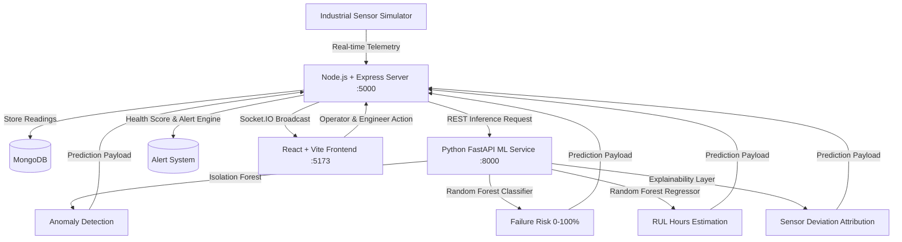

# Predictive Maintenance Intelligence System (PMIS)

An AI-powered industrial predictive maintenance platform designed to monitor manufacturing machinery, detect early abnormal sensor anomalies, estimate Remaining Useful Life (RUL), predict equipment failure probabilities, and provide explainable AI root-cause diagnostics.

---

## 🏭 Core Architecture



---

## 🚀 Key Features

1. **Real-time Machine Monitoring**: Live sensor streaming (Temperature, Vibration, Pressure, RPM, Current, Voltage, Acoustic Level).
2. **AI Anomaly Detection**: Unsupervised Isolation Forest model detecting multidimensional sensor drifts.
3. **Failure Risk Prediction**: Machine learning classifier predicting failure probabilities (Low, Medium, High).
4. **Remaining Useful Life (RUL)**: Regression model predicting operational hours before critical failure.
5. **Explainable AI (XAI)**: Identifies specific contributing sensor features and human-readable mechanical diagnoses (e.g. bearing wear, cavitation, motor winding degradation).
6. **Dynamic Health Scoring (0–100%)**: Composite health calculation synthesizing sensor bands and ML risk outputs.
7. **Interactive Alert Triage**: Real-time notifications with Acknowledge and Resolve workflows.
8. **Maintenance Scheduling**: End-to-end task tracking (Scheduled, In Progress, Completed, Cancelled).
9. **Simulated Degradation Mode**: Built-in simulator with multi-stage degradation for machine `CNC-004`.
10. **Role-Based Access Control**: Tailored portals for **Admin**, **Maintenance Engineer**, and **Operator**.

---

## 🛠️ Technology Stack

- **Frontend**: React 18, Vite, Tailwind CSS, Recharts, Lucide React, Axios, React Router v6, Socket.IO Client.
- **Backend**: Node.js, Express.js, MongoDB, Mongoose, Socket.IO, JWT, bcryptjs.
- **Machine Learning**: Python 3.10+, FastAPI, Scikit-learn, Pandas, NumPy, Joblib, Uvicorn.
- **Packaging & DevOps**: Docker, Docker Compose.

---

## 📦 Monorepo Structure

```
predictive-maintenance-system/
├── frontend/                  # React Vite Tailwind Dashboard
│   ├── src/
│   │   ├── components/        # Reusable UI widgets (Gauges, Cards, Modals)
│   │   ├── pages/             # Dashboard, Machines, Live, Maintenance, etc.
│   │   ├── services/          # Centralized Axios API instances
│   │   ├── context/           # AuthContext & SocketContext
│   │   ├── App.jsx
│   │   └── main.jsx
│   ├── package.json
│   └── vite.config.js
├── backend/                   # Node.js Express & Socket.IO
│   ├── controllers/           # Auth, Machine, Sensor, Alert, Maintenance
│   ├── models/                # Mongoose Models (User, Machine, Sensor, Alert, etc.)
│   ├── routes/                # REST endpoints
│   ├── services/              # ML caller, Alert engine, Sensor simulator
│   ├── scripts/seed.js        # Realistic demo database seeder
│   ├── server.js              # Application entry point
│   └── package.json
├── ml-service/                # Python FastAPI ML Engine
│   ├── data/                  # Synthetic degradation dataset generator
│   ├── models/                # Trained Joblib model artifacts
│   ├── preprocessing/         # Feature scaling & normalization
│   ├── prediction/            # Inference engine & Explainability module
│   ├── training/              # Isolation Forest & Random Forest trainers
│   ├── main.py                # FastAPI REST API endpoints
│   └── requirements.txt
├── docker-compose.yml
└── README.md
```

---

## ⚙️ Quick Start Guide

### 1. Prerequisites
- Node.js (v18+)
- Python (v3.9+)
- MongoDB running locally (`mongodb://localhost:27017/predictive_maintenance`) or MongoDB Atlas URI

---

### 2. Python ML Service Setup
```bash
cd ml-service
python -m venv venv

# Windows:
venv\Scripts\activate
# Linux/macOS:
source venv/bin/activate

pip install -r requirements.txt

# Train models & generate synthetic dataset:
python data/generate_dataset.py
python training/train_models.py

# Start FastAPI server on port 8000:
uvicorn main:app --reload --port 8000
```

---

### 3. Node.js Backend Setup
```bash
cd backend
npm install

# Seed initial demo database with machines, sensor history, and demo users:
npm run seed

# Start Express & Socket.IO server on port 5000:
npm run dev
```

---

### 4. React Frontend Setup
```bash
cd frontend
npm install

# Start Vite dev server on port 5173:
npm run dev
```

Visit **`http://localhost:5173`** in your browser.

---

## 🔑 Demo Credentials

| Role | Email | Password |
|---|---|---|
| **Admin** | `admin@factory.com` | `password123` |
| **Maintenance Engineer** | `engineer@factory.com` | `password123` |
| **Operator** | `operator@factory.com` | `password123` |

---

## 🧪 Interactive Demo Degradation Flow

1. Log in as **Maintenance Engineer** (`engineer@factory.com`).
2. Navigate to **Live Monitoring** page.
3. Click **"Start Simulation"**.
4. Observe **CNC-004**:
   - Initial normal behavior: Vibration ~2.4 mm/s, Temperature ~52°C, Health 92%.
   - Over consecutive cycles, artificial bearing degradation introduces high-frequency vibration spikes (>7.5 mm/s) and thermal elevation (>86°C).
   - AI generates an Anomaly detection flag (`ANOMALY`), increases Failure Probability to `91%`, and drops RUL to `~18 hours`.
   - Real-time **CRITICAL Alert** fires on the screen with visual badge and notification tray.
   - Click the alert or machine to view the **AI Explanation**: `Vibration (45%)` and `Temperature (32%)` identified as prime culprits with recommendation to inspect bearing assembly.
   - Click **Schedule Maintenance** -> assign technician -> mark as **Completed**.
   - Machine resets to healthy status (Health: 98%).

---

## 📄 License & Academic Note
Developed for AI/ML and MERN industrial IoT educational demonstrations. The machine degradation patterns are scientifically modeled based on realistic turbomachinery and rotary motor degradation data.
